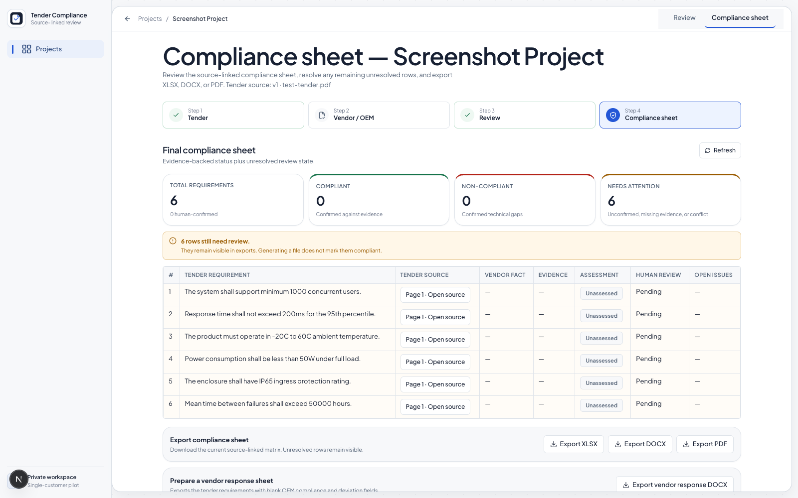

<p align="center">
  
</p>

<h1 align="center">Tender Compliance Engine</h1>

<p align="center">
  <strong>Turn technical tenders into source-linked requirements that people can review and export.</strong>
</p>

<p align="center">
  
  
  
  
  
</p>


---

## See the workflow

The screenshots below use synthetic test data. They show the current interface and do not represent a completed client tender or a compliance decision.


### 1. Upload and organize the tender

The project workspace keeps tender source versions and vendor/OEM material together, with processing state and the next review action visible.


### 2. Review requirements against the cited source

Reviewers can inspect extracted requirements alongside the rendered tender page. Source wording and location remain visible so uncertain extraction can be checked against the document.


### 3. Inspect the compliance sheet

The matrix brings tender requirements, source links, available vendor facts, evidence, assessment state, and human review into one view. Missing evidence remains a review state; it is not presented as non-compliance.



## Product scope

The current product flow is:

```text
Tender upload
  → parsing and OCR
  → source-linked requirement extraction
  → human review and correction
  → vendor/OEM evidence review
  → evidence-backed assessment
  → compliance matrix and export
```

The generated compliance sheet is limited to product/equipment specifications from the tender's technical-specification section or clearly identifiable specification tables. Separate eligibility, past-performance, supporting-proof, delivery, installation, warranty, maintenance, service, and bid-process clauses are excluded. The system preserves the original document and the source location it actually knows. OCR uncertainty stays visible for review. Numerical values and units are evaluated deterministically where supported; a model response or successful export is not proof that a tender is complete.

Supported file inputs include PDF and DOCX. The app can export the compliance sheet as XLSX, DOCX, and PDF. See [the architecture guide](docs/ARCHITECTURE.md) for system boundaries and [the checkpoint plan](docs/checkpoint.md) for implementation status.

## Current readiness

**The product workflow is implemented, but the example set and client acceptance are not signed off.** Checkpoint 70 remains in progress. Its open work includes human classification of sample findings, tender-wide completeness decisions, and a full acceptance run in the intended client environment. See [Checkpoint 70](docs/checkpoint.md#L3533) and the [release review checklist](docs/POST61_RELEASE_REVIEW.md).

Known sample-review work includes exact-wording differences, possible omitted requirements, blank response-sheet decisions, and unresolved coverage findings. These require review against the original pages and the supplied response sheets. The app must not infer a supplier decision from an empty cell or treat an unconfirmed possible omission as a fact.

The private pilot has no user sign-in and is intended for local or trusted private-network use. Do not expose it directly to the public internet. Production use still needs client-specific identity, storage, malware-scanning, backup, and service-health configuration.

GitHub Actions verification is temporarily unavailable because the repository account has a billing/spending restriction. This README does not treat blocked jobs as passing checks. Restore billing and rerun the required workflows before release sign-off.

## Start a private pilot

Prerequisites: Docker with Compose support, and an OpenAI-compatible API credential configured for the selected model endpoint.

```bash
cp .env.example .env
# Add the required AI endpoint/key/model settings to .env
make pilot-start
```

The startup command validates configuration, starts the database, queue, scanner, API, processing worker, and web app, and waits for the readiness endpoint. Open [http://localhost:3000](http://localhost:3000). Keep `.env` private; never commit credentials.

For direct local development, see the Makefile targets and [the development notes](docs/ARCHITECTURE.md). The bundled pilot creates one workspace and is not a multi-tenant SaaS deployment.

## How source and review states work

- A requirement keeps its tender source wording, document version, page or clause when known, and approximate/exact location status.
- Reviewers can edit, split, merge, reorder, confirm, or flag extracted requirements while retaining the audit trail.
- Accepted vendor evidence links to its source document and version.
- Missing evidence is not the same as contradictory evidence or non-compliance.
- OCR ambiguities and unverified coverage findings require human review.
- Export and submission controls reflect unresolved validation findings; a generated file alone does not certify completeness.

## Architecture

```text
Next.js web app
      │
      ▼
FastAPI API ─── PostgreSQL
      │
      ├── shared pilot volume for originals, page renders, and exports
      ├── Redis-backed processing worker
      ├── ClamAV upload scanning
      ├── Tesseract OCR
      └── OpenAI-compatible extraction and bounded language interpretation
```

The pilot is a compact application stack, not a microservice mesh. Storage and provider integrations sit behind adapters so a later deployment can use managed services without changing the product's source-traceability rules.

## Repository map

```text
apps/api/              API, application services, persistence, and worker
apps/web/              Project, upload, review, source viewer, matrix, and export UX
docs/                  Architecture, security, evaluation, release review, and checkpoint plan
infra/                 Local infrastructure configuration
docker-compose.yml      Bundled private-pilot stack
AGENTS.md               Contribution and product guardrails
```

## Development checks

The repository's GitHub Actions workflows run backend checks, extraction/citation and security gates, frontend type-check/build, container builds, and bundled-stack smoke checks. Run the focused checks for the area you change; the required GitHub workflows must also pass before normal release sign-off.

Current local verification for this branch will be recorded in its pull request. CI remains pending until the billing restriction is resolved.

## Design and product principles

- Never invent a technical requirement, citation, page, source quote, or supplier status.
- Preserve source wording and distinguish exact from approximate locations.
- Keep OCR uncertainty visible instead of silently correcting it.
- Prefer conservative human review over unsupported certainty.
- Treat uploaded files as untrusted input and document text as data, never as application instructions.

See [the design notes](apps/web/DESIGN.md), [security guidance](docs/SECURITY.md), and [the canonical checkpoint plan](docs/checkpoint.md).
