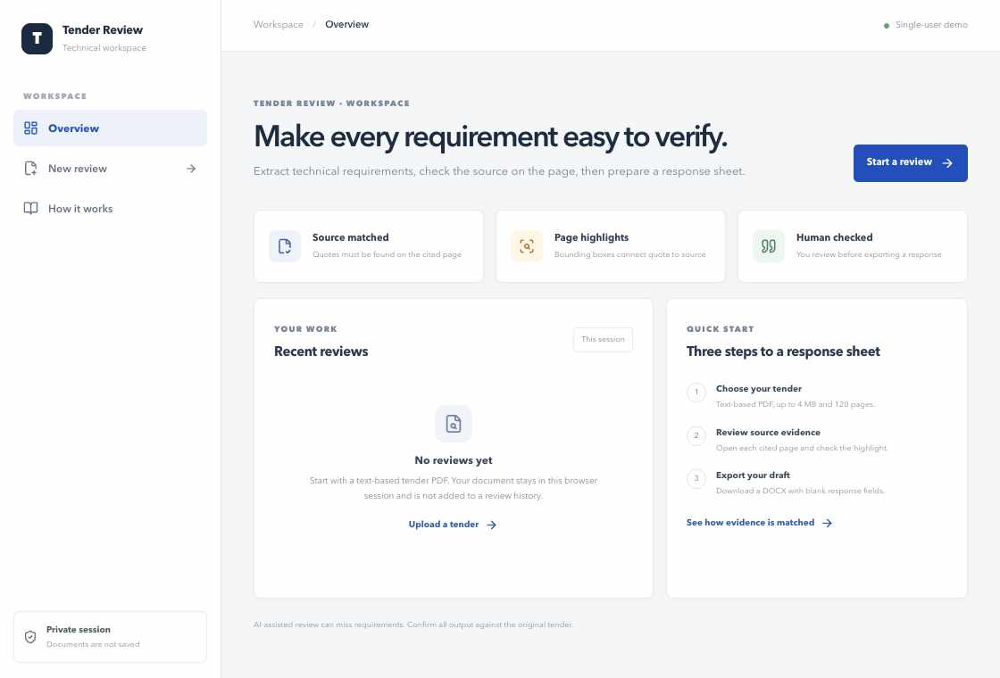
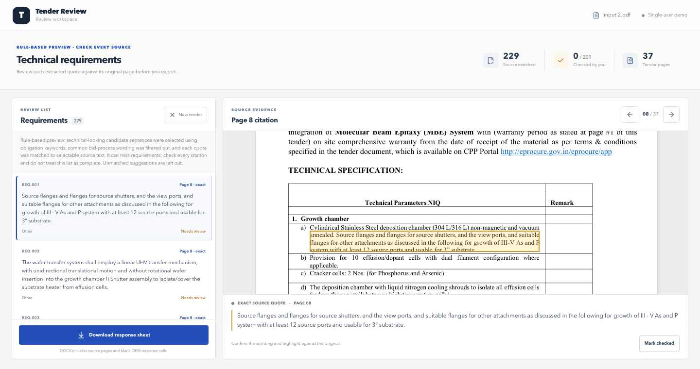
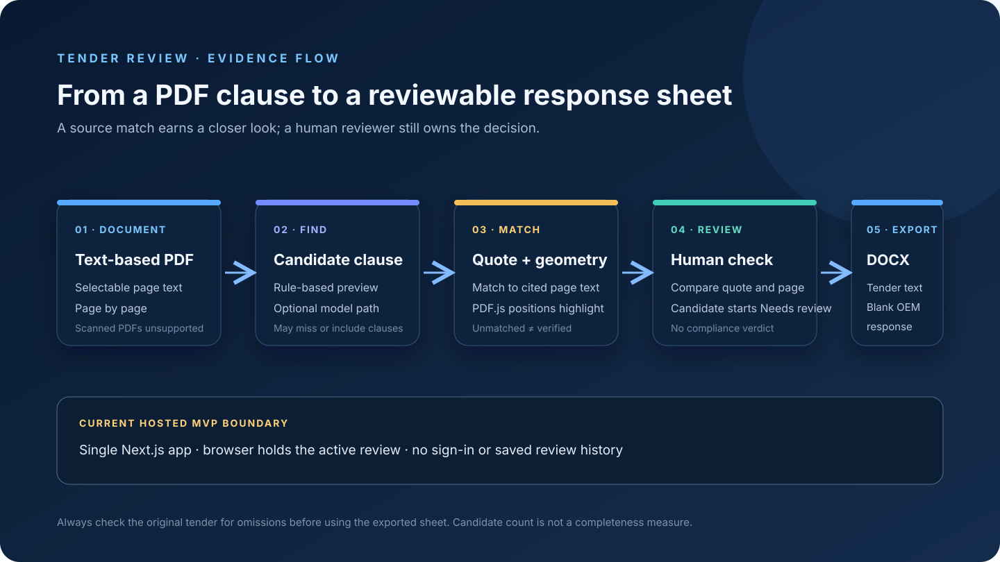

<div align="center">
  

  <h1>Tender Review</h1>

  <p><strong>Turn tender PDFs into source-linked OEM response sheets.</strong><br />
  Review each candidate against its original page, then export the tender wording with blank supplier response fields.</p>

  <a href="https://tender-compliance-engine.vercel.app/"></a>
  
  
  

  <br /><br />

  <a href="https://tender-compliance-engine.vercel.app/">
    
  </a>
</div>

## What it does

Tender Review is a focused single-user demo for preparing a technical response sheet from a text-based tender PDF. It finds candidate clauses, links each candidate to selectable text on its cited page, displays a page highlight, and exports a DOCX with blank OEM response fields.

The app does not decide whether a supplier complies. Every candidate starts in **Needs review** and should be checked against the original tender.

## Screenshots

The screenshots below are real captures from the hosted MVP. The review example uses a sample PDF and shows the currently deployed **rule-based preview**. Its candidate list can include false positives and can miss requirements; the count is not a completeness measure, and the example rows have not been approved by a reviewer.

<p align="center">
  
</p>

The yellow page highlight is positioned from the matched source text. Selecting a candidate opens its citation and quote; the reviewer can compare both with the original page before marking it checked.

## Try the hosted demo

Open [Tender Review on Vercel](https://tender-compliance-engine.vercel.app/). Upload a readable, text-based PDF (up to 4 MB and 120 pages), choose a candidate, inspect its citation and page highlight, and download the response sheet.

The current hosted run uses the rule-based preview. When a server-side OpenAI-compatible model is configured, the model-assisted path groups pages into bounded requests and asks the model to inspect complete technical schedule rows, including their attached bullets. Every proposed quote still has to match selectable text on its cited page before it is shown. The model key remains server-side.

## How a citation is produced

```text
Tender PDF
   ↓
Read selectable text page by page
   ↓
Choose candidate rows (rule-based preview or configured model page groups)
   ↓
Match the quote back to the cited page and locate its PDF text geometry
   ↓
Show the quote, page number, and bounding-box highlight for human review
   ↓
Export the source wording and blank OEM response cells to DOCX
```

PDF.js reads the PDF text and provides the page-coordinate geometry used by the highlight overlay. Quotes that cannot be matched to the cited page with usable geometry are not presented as verified citations. A visible source match still does not prove that the whole tender has been covered.

## Run locally

Prerequisites: Node.js 20+, npm, and an OpenAI-compatible model credential for the model-assisted path.

```sh
git clone https://github.com/ayushcodes13/tender-compliance-engine.git
cd tender-compliance-engine
cp .env.example .env.local
# Add OPENAI_API_KEY to .env.local.
# For an Azure-compatible endpoint, also set OPENAI_BASE_URL and OPENAI_MODEL.
make web-install
make pilot-start
```

Open [http://127.0.0.1:3307](http://127.0.0.1:3307). Stop the local app with:

```sh
make pilot-stop
```

## Architecture

The hosted MVP is one Next.js app deployed on Vercel. A server-side route handles PDF analysis and any configured model request; the browser renders the original PDF, shows source highlights, holds the active review, and creates the DOCX.

<p align="center">
  
</p>

There is no separate API service, worker, database, job queue, or Docker stack in the deployed MVP. Uploaded files and review results are not saved as a project history. The hosted site has no sign-in, so use a non-confidential sample document.

## Limits

- Both extraction paths are candidate finders, not exhaustive extraction systems. The model-assisted path preserves source table-row grouping, checks every proposed quote against its cited page, and drops unmatched suggestions; it can still miss requirements or suggest irrelevant clauses.
- A document producing more than 250 matched rows is rejected for this MVP instead of silently truncating the review.
- Scanned PDFs and OCR-heavy files are not supported by the current demo.
- Review each candidate and check the original tender for omissions before using the exported sheet.
- Refreshing or closing the browser clears the current review. Download the DOCX before leaving the page.
- The hosted preview accepts PDFs up to 4 MB, 120 pages, and 140,000 characters of selectable text per run.

## Links

- [Live MVP](https://tender-compliance-engine.vercel.app/)
- [Portfolio](https://devayushrout.me/)
- [How the evidence match works](https://tender-compliance-engine.vercel.app/method)
